# WarehouseOps

**Full-stack warehouse operations platform | ASP.NET Core · React · TypeScript · SQL Server**

WarehouseOps is a portfolio project that simulates the day-to-day operations of a fictional B2B technology distributor. It brings product management, inventory, customers, orders, shipments, incidents and audit history into one web application.

The project demonstrates how I design, implement, test and run a complete application, with particular attention to **backend architecture, data integrity, authentication, authorization and maintainability**. It is a **layered monolith**, deliberately chosen over microservices to keep the system cohesive and its complexity appropriate for the domain.

**Current milestone (2 November 2026):** Core features are implemented and running locally with Docker Compose. ASP.NET Core Identity, JWT authentication and the three user roles have been verified with SQL Server. **223 backend tests passed**, and the frontend production build succeeded. Further OWASP testing and deployment hardening are planned.

## Application preview

**Sign in**

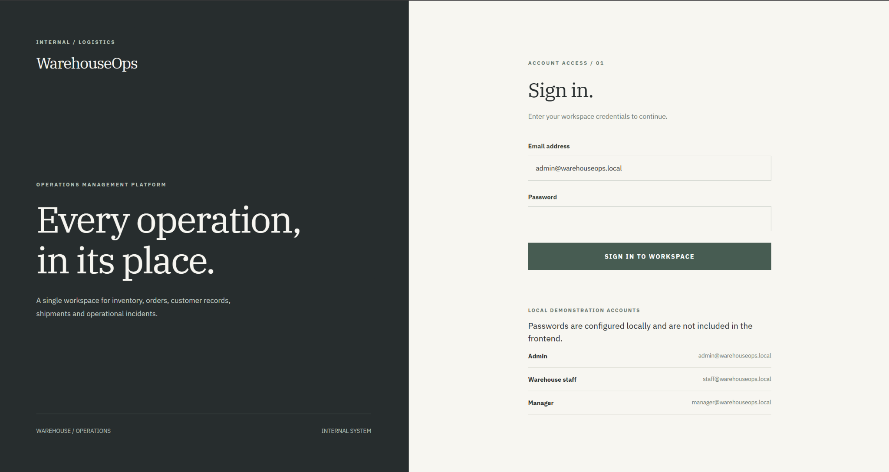

**Operations dashboard**

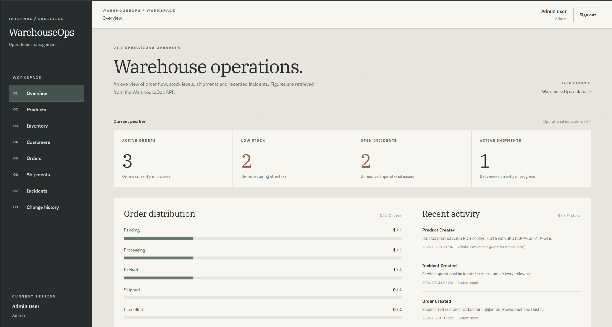

<details>
<summary><strong>View more screenshots</strong></summary>

The sidebar adapts to the user's role. For example, Admin and Manager can access Change history, while WarehouseStaff cannot.

| WarehouseStaff | Manager |
|---|---|
| 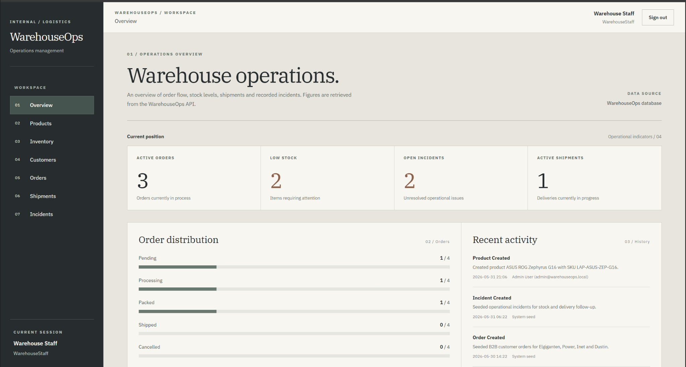 | 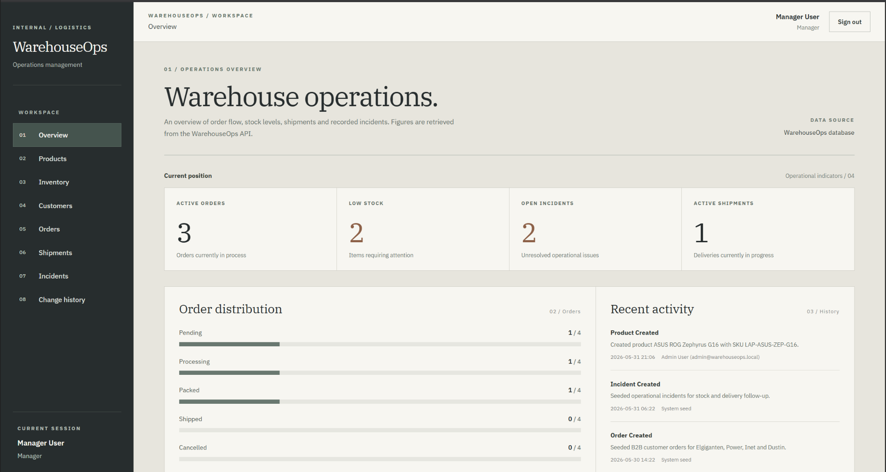 |

| Products | Inventory | Customers |
|---|---|---|
| 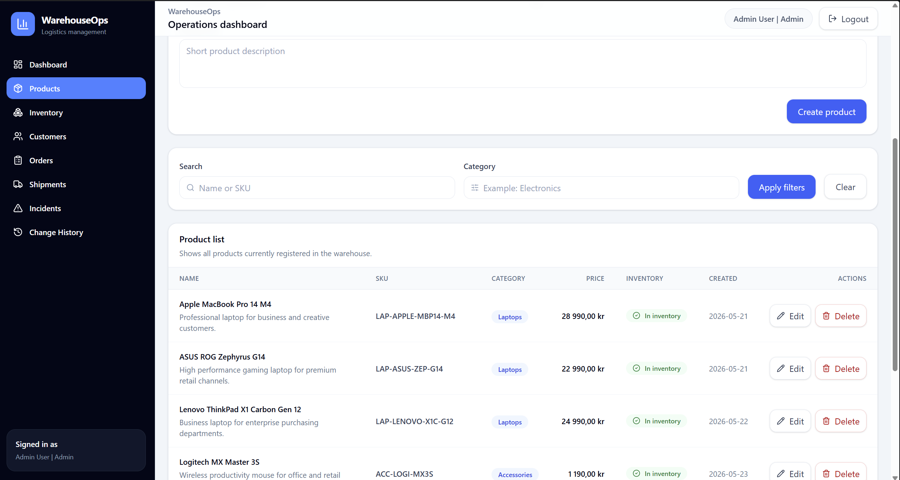 | 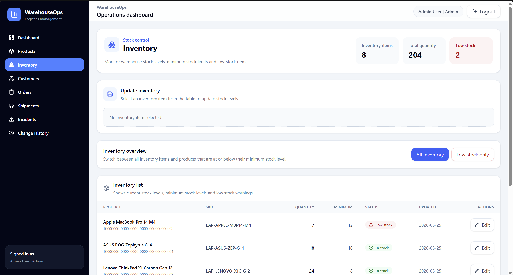 | 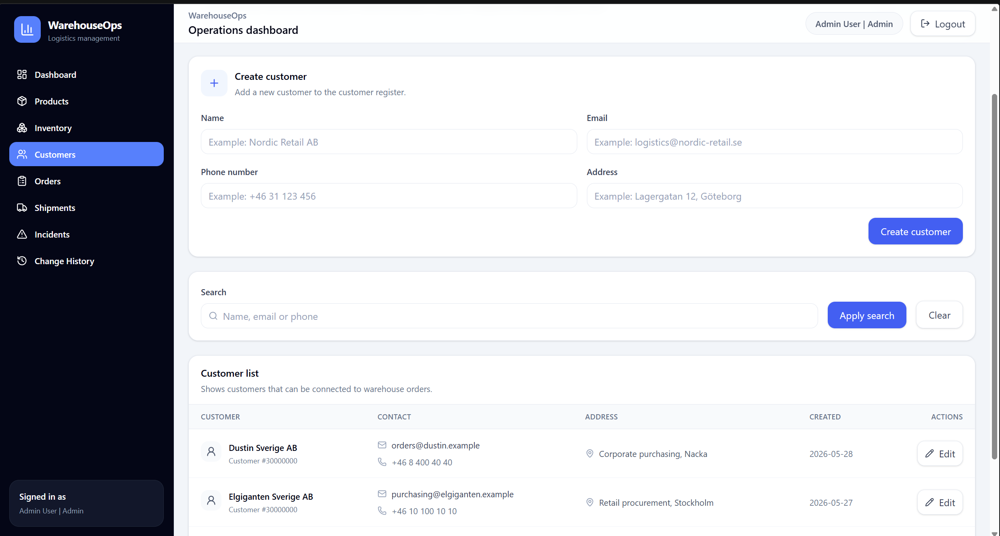 |

| Orders | Shipments | Incidents |
|---|---|---|
| 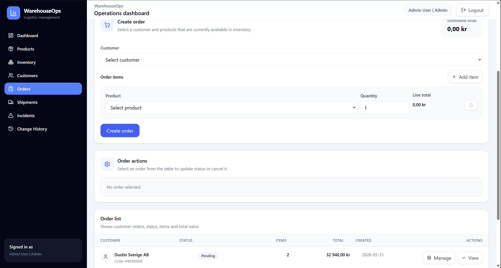 | 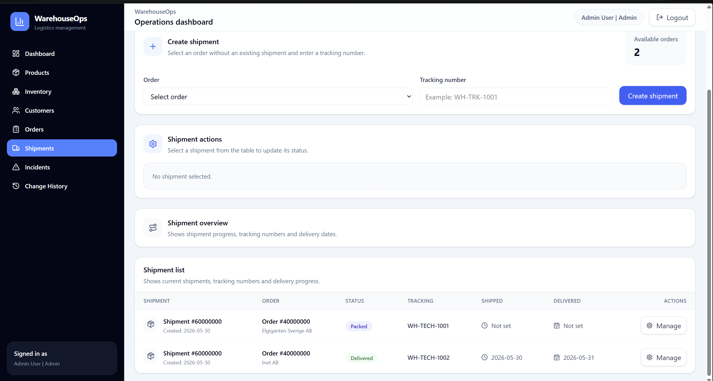 | 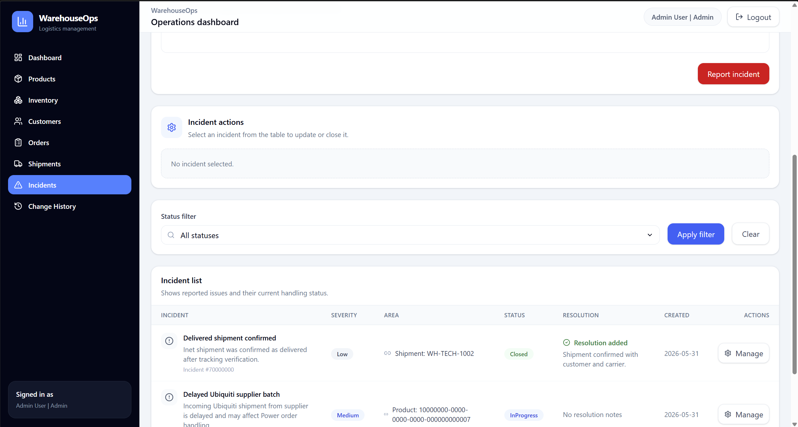 |

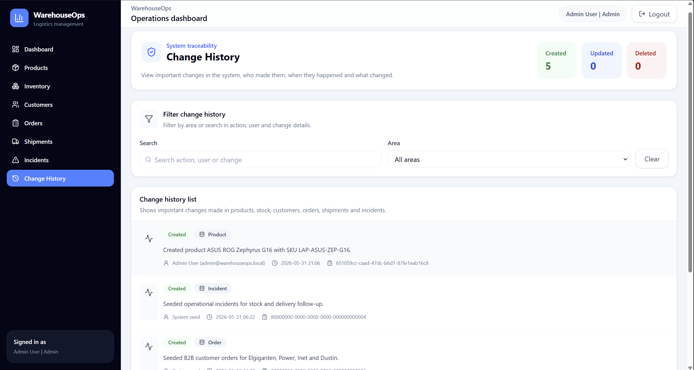

</details>

## Engineering highlights

| Challenge | Implementation |
|---|---|
| **Maintainable backend structure** | Separate `Api`, `Application`, `Domain` and `Infrastructure` projects. Controllers handle HTTP; application services own business rules; repositories encapsulate EF Core persistence. |
| **Consistent business operations** | Transaction decorators wrap changes to products, inventory, customers, orders, shipments and incidents, so related database writes and audit records can commit or roll back together. |
| **Concurrent inventory updates** | SQL Server `rowversion` provides optimistic concurrency checking for inventory records. Concurrency exceptions are translated into an application-specific error. |
| **Authentication and access control** | ASP.NET Core Identity stores users, roles and password hashes in SQL Server. Successful login produces a signed JWT. Backend endpoints enforce `Admin`, `WarehouseStaff` and `Manager` permissions. |
| **Traceability** | Audit entries record important business changes, including the authenticated user's identity, while access to audit history is restricted by role. |
| **Repeatable verification** | xUnit, Moq, FluentAssertions and HTTP integration tests cover business rules, JWT validation and authorization. GitHub Actions builds and tests the backend and builds the frontend. |

These choices are implemented in the repository, not only described in documentation. The tests provide evidence for specific behaviors; they do not imply that every production scenario has been verified.

## Technology stack

| Area | Technologies |
|---|---|
| Backend | C#, .NET 10, ASP.NET Core Web API, Entity Framework Core 10, SQL Server, ASP.NET Core Identity, JWT, Swagger |
| Frontend | React, TypeScript, Vite, React Router, Axios, TanStack React Query, React Hook Form, Zod, Tailwind CSS, Lucide React, Recharts |
| Tests | xUnit, Moq, FluentAssertions, ASP.NET Core `WebApplicationFactory` |
| DevOps | Docker, Docker Compose, GitHub Actions |

## Core functionality

- **Products:** Create, browse, update, delete, search and filter products. Protect records referenced by inventory or orders.
- **Inventory:** Track quantities, minimum stock levels and low-stock items; prevent invalid stock changes.
- **Customers:** Maintain customer records for the fictional B2B operation.
- **Orders:** Create orders, manage statuses, reserve available stock and restore stock when eligible orders are cancelled.
- **Shipments:** Associate shipments with orders and track delivery status.
- **Incidents:** Report, update, resolve and close warehouse-related incidents.
- **Dashboard:** View active orders, low-stock alerts, open incidents, shipments, order status distribution and recent activity.
- **Audit history:** Track significant operational changes with actor and timestamp information.

### Roles and permissions

| Permission | Admin | WarehouseStaff | Manager |
|---|:---:|:---:|:---:|
| Read operational data and dashboard | Yes | Yes | Yes |
| Manage product catalog | Yes | No | No |
| Manage inventory | Yes | Yes | No |
| Manage customers and orders | Yes | Yes | No |
| Manage shipments and incidents | Yes | Yes | No |
| View audit history | Yes | No | Yes |

**Authorization is enforced by the API.** The frontend also adjusts available navigation and actions, but hiding a button is not treated as a security control.

## Architecture and design decisions

| Project | Responsibility |
|---|---|
| `WarehouseOps.Api` | Controllers, HTTP middleware, JWT bearer validation, role authorization and Swagger |
| `WarehouseOps.Application` | Use-case services, business validation, DTOs, interfaces and transaction decorators |
| `WarehouseOps.Domain` | Business entities and enums |
| `WarehouseOps.Infrastructure` | EF Core DbContext, SQL Server repositories, migrations, ASP.NET Core Identity and JWT generation |
| `WarehouseOps.Tests` | Business-rule tests, HTTP security integration tests and EF model tests |

**Why a layered monolith?** The system needs clear boundaries between business rules, persistence and HTTP, but does not require independently deployed services. One backend keeps local development and testing straightforward while still demonstrating separation of concerns and dependency inversion.

**Why explicit transaction boundaries?** An order operation may affect multiple records, including inventory and audit history. Transaction decorators keep this coordination outside controllers and prevent a partially committed business operation if an exception occurs.

**Why optimistic concurrency?** Two warehouse users could edit the same inventory record. A database `rowversion` allows EF Core to detect conflicting updates rather than silently accepting the last write.

For implementation detail, see [Architecture](docs/architecture.md), [Database design](docs/database_design.md) and [SOLID and GRASP](docs/design_principles_solid_grasp.md).

## Security

The current implementation includes:

- ASP.NET Core Identity for users, password hashing, email confirmation requirements, role membership and configured account lockout.
- Signed JWT bearer tokens with issuer, audience, signing-key and expiration validation.
- Backend role authorization and HTTP `401`/`403` behavior for protected routes.
- Per-IP login rate limiting, configured for five requests per minute.
- EF Core LINQ queries rather than concatenated raw SQL using user input.
- Backend input validation, safe exception responses, and audit logging.
- Secrets loaded from local configuration rather than committed source files.
- Docker ports restricted to localhost, with SQL Server kept on the internal Docker network.

**Security verification completed:** HTTP tests for JWT validation and role restrictions, plus manual checks using real local Identity accounts and the running SQL Server. Tested responses included `401` for anonymous or invalid-token requests, `403` for forbidden operations and `404` for an authorized request targeting a nonexistent product.

**Known limitations:** The React app currently stores its JWT in `localStorage`. Signing out removes the browser's token but does not revoke an already-issued token server-side. The Docker setup is for local development, not a hardened HTTPS deployment. Identity account lockout still needs dedicated real-database verification.

**Planned, not yet performed:** SQL Injection payload testing, broader OWASP negative tests, object-level access checks, mass-assignment checks and additional database-backed security tests. Using EF Core reduces SQL Injection risk but is not proof of completed penetration testing.

See [Security and OWASP](docs/security_owasp.md) for controls, evidence and open issues.

## Testing and CI

**Latest verified local run, 2 November 2026: 223 passed, 0 failed, 0 skipped.**

```powershell
cd backend
dotnet restore WarehouseOps.sln
dotnet build WarehouseOps.sln --no-restore
dotnet test WarehouseOps.sln
```

The automated suite covers business rules, validation, transactional behavior, inventory concurrency, authentication-service logic, JWT validation, role authorization and Identity model mapping. HTTP tests use `WebApplicationFactory`; many use mocked dependencies, so they do not constitute a full database end-to-end suite.

Additional manual checks confirmed successful SQL Server-backed logins for all three roles, correct API permissions, dashboard data and browser logout.

Frontend build:

```powershell
cd frontend/warehouseops-client
npm install
npm run build
```

[GitHub Actions CI](.github/workflows/ci.yml) runs .NET restore, build and tests, as well as the frontend install and build, on pushes and pull requests to `main`. Docker image builds and penetration tests are not currently part of CI.

See [Testing](docs/testing.md) for detailed coverage and limitations.

## Run locally with Docker

**Prerequisite:** Docker Desktop with Docker Compose.

```powershell
git clone https://github.com/LovisaLundqvist/WarehouseOps.git
cd WarehouseOps
Copy-Item .env.example .env
notepad .env
```

Set all placeholder values in `.env`. `JWT_SECRET_KEY` must be at least 32 characters. The three demo passwords must be different and comply with the Identity password policy: at least 12 characters, uppercase, lowercase, a digit and a special character.

```dotenv
SA_PASSWORD=REPLACE_WITH_STRONG_LOCAL_SQL_PASSWORD
JWT_SECRET_KEY=REPLACE_WITH_STRONG_LOCAL_JWT_SECRET_AT_LEAST_32_CHARACTERS
DEMO_ADMIN_PASSWORD=REPLACE_WITH_STRONG_LOCAL_ADMIN_PASSWORD
DEMO_STAFF_PASSWORD=REPLACE_WITH_STRONG_LOCAL_STAFF_PASSWORD
DEMO_MANAGER_PASSWORD=REPLACE_WITH_STRONG_LOCAL_MANAGER_PASSWORD
```

**Do not commit `.env`.** The repository's `.env.example` contains placeholders only.

```powershell
docker compose config --quiet
docker compose up -d --build
docker compose ps
```

| Service | Local address |
|---|---|
| React frontend | http://localhost:3000 |
| Swagger UI (Development) | http://localhost:5059/swagger |
| SQL Server | Internal Docker network only |

The local Development environment applies EF Core migrations and seeds fictional business data. It also provisions demo Identity users when enabled in Docker Compose.

| Role | Email | Password |
|---|---|---|
| Admin | `admin@warehouseops.local` | Local `DEMO_ADMIN_PASSWORD` |
| WarehouseStaff | `staff@warehouseops.local` | Local `DEMO_STAFF_PASSWORD` |
| Manager | `manager@warehouseops.local` | Local `DEMO_MANAGER_PASSWORD` |

Demo provisioning does not reset an existing user's password when `.env` changes. These accounts are intended only for local demonstrations.

```powershell
# Stop containers but retain database data
docker compose down

# CAUTION: Removes the SQL Server database volume and its data
docker compose down -v
```

For standalone development, the backend can use a separately configured local SQL Server/LocalDB instance and the frontend can be started with `npm run dev` from `frontend/warehouseops-client`. The local backend database is not automatically the same database as the Docker instance.

## Project status and next steps

**Implemented:** Business APIs and React screens, dashboard, audit history, EF Core migrations, Identity accounts, JWT authorization, local Docker deployment, GitHub Actions and automated backend tests.

**Next priorities:** Verify Identity lockout behavior; execute and document SQL Injection and broader OWASP security tests; extend database-backed integration tests; review JWT storage and revocation; improve production-oriented configuration and deployment security.

WarehouseOps is an evolving **engineering portfolio project**, not a deployed commercial product or an independently audited security solution. Claims in this README reflect implemented code and the tests completed so far.
